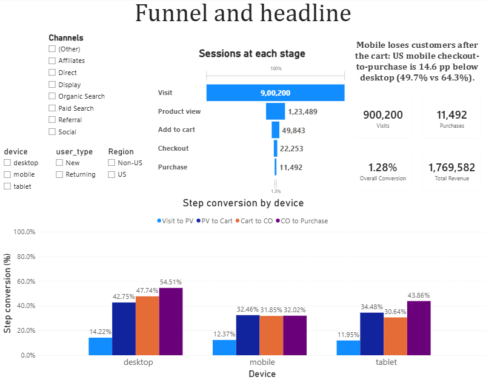
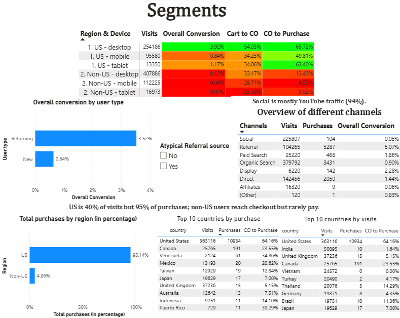
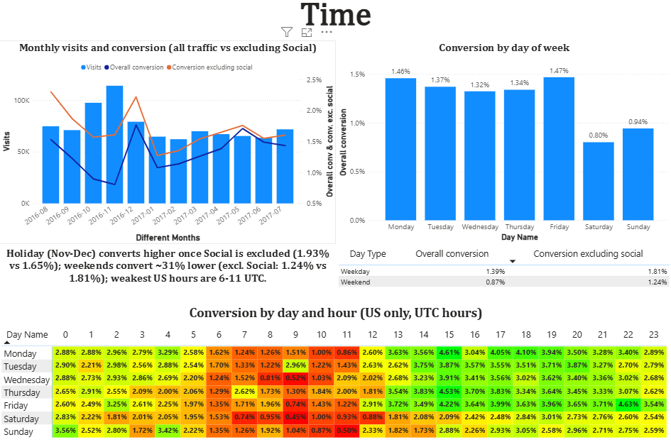
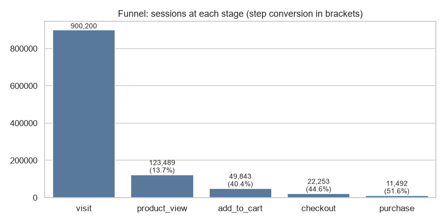
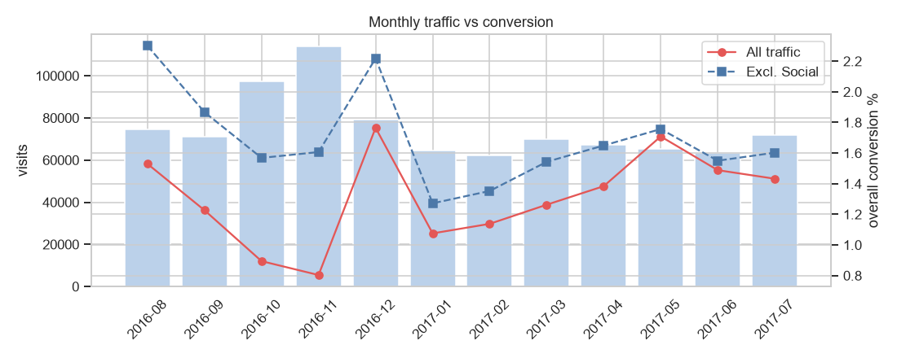
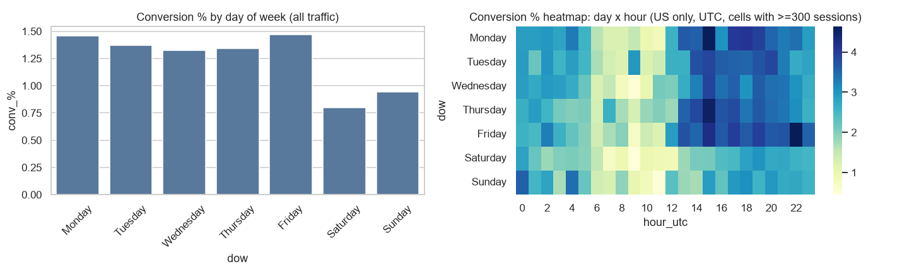

# End-to-End Funnel Analysis: Where are we losing customers in the journey?

> **Headline:** Mobile visitors reach the cart but do not finish checkout. In the US, mobile's checkout-to-purchase rate is **49.7% vs 64.3% on desktop** (-14.6 pp, 95% CI -17.3 to -12.0, p < 0.001), and mobile converts **0.41% vs 1.58%** overall. A second, separate leak: non-US visitors reach checkout but almost never pay (about 11% vs 64% in the US).

I wanted to find at which stage customers leave the funnel, and which segments leak the most. The biggest finding is that **95% of purchases** come from one country, the US. What surprised me is that visitors who went straight to checkout **converted lower (43.8%)** than visitors who went through the full journey from product view to purchase **(53.1%, p < 0.001)**.

## Dashboard
| Funnel and headline | Segments | Time |
|---|---|---|
|  |  |  |

Dashboard file: `dashboard/funnel_analysis.pbix` (Power BI, data source: CSV export of the MySQL `sessions` table).

## 1. Problem
An e-commerce store loses customers somewhere between visit and purchase. Funnel: **Visit → Product view → Add to cart → Checkout → Purchase**.
Questions: Where is the biggest drop-off? Which segments (device, location, user type, channel) and which times make it worse? What should be fixed first?

## 2. Data
Google Analytics sample dataset, Google Merchandise Store (real, anonymised e-commerce data).
`bigquery-public-data.google_analytics_sample.ga_sessions_*`, 1 Aug 2016 to 31 Jul 2017.
**900,200 sessions** after removing 897 duplicate session IDs.

## 3. Approach
| Step | What | File |
|---|---|---|
| 1 | Flatten nested GA `hits` into one row per session with funnel flags (BigQuery SQL) | `sql/01_bigquery_flatten.sql` |
| 2 | Load into MySQL | `sql/02_mysql_schema.sql`, `python/02_extract_and_load.py` |
| 3 | Funnel, segmentation, time analysis (MySQL 8) | `sql/03_mysql_analysis.sql` |
| 4 | Significance tests, Simpson's paradox checks, lost revenue, charts (Python) | `notebook/funnel_analysis.ipynb` |
| 5 | Dashboard (Power BI) | `dashboard/funnel_analysis.pbix` |

Tools: BigQuery, MySQL 8, Python (pandas, scipy, statsmodels, seaborn), Power BI.

## 4. Overall funnel
| Stage | Sessions | Step conversion | Drop-off |
|---|---|---|---|
| Visit | 900,200 | - | - |
| Product view | 123,489 | 13.72% | 86.28% |
| Add to cart | 49,843 | 40.36% | 59.64% |
| Checkout | 22,253 | 44.65% | 55.35% |
| Purchase | 11,492 | 51.64% | 48.36% |

Overall conversion: **1.28%**. The biggest raw drop is Visit → Product view (mostly bounce and homepage-only traffic), so the first real leak in the buying journey is **Product view → Add to cart (59.6% drop)**.


## 5. Key findings
**Bottleneck by segment**
| Segment | Where it leaks | Evidence |
|---|---|---|
| Mobile (US) | After the cart: starting checkout and paying | Cart→Checkout 34.3% vs 54.1% desktop; Checkout→Purchase 49.7% vs 64.3% (excl. one atypical source) |
| Non-US visitors | Payment | Checkout→Purchase about 11% (0% to 24% by country) vs 64% in the US; India 1.6%, Vietnam 0% |
| New users | Every stage | 0.64% vs 3.52% for returning users |
| Social channel | Before the product page | Visit→Product view only 2.1%; 94% of Social is youtube.com |

**Device.** Desktop 1.58%, mobile 0.41%, tablet 0.55%. The mobile gap widens down the funnel: -1.9 pp (visit→product), -10.3 pp, -15.9 pp, **-22.5 pp (checkout→purchase)**, all p < 0.001. Mobile orders are also smaller (US median $30 vs $55).

**Location.** The US is 40% of visits but **95% of purchases**. Non-US visitors add to cart at similar rates but rarely complete payment. City data is masked in the demo dataset, so location is country-level.

**User type.** Returning users are 22% of visits but 61% of purchases and convert 5.5x higher.

**Channel.** Referral shows 5.07%, but 96.5% of its purchases come from one `(direct)` source label, so it is not a clean "channel quality" result. Social brings 25% of sessions and 0.9% of purchases (mostly YouTube).

**Time.**
- Excluding Social, **Nov-Dec converts higher than other months (1.93% vs 1.65%)** and early January is weakest (1.28%). Including Social reverses the holiday result, because Social traffic spiked in Oct-Nov and rarely buys.
- Weekends convert about 31% lower than weekdays (1.24% vs 1.81%, excl. Social), mainly on desktop.
- In the US, 14-22 UTC converts about 3.5% vs about 1.4% for 6-11 UTC, but the weak window holds only about 8% of US traffic.
- Median time from first product view to purchase (same session): 10.4 minutes.




## 6. Unexpected findings
>  **Visitors who went straight to checkout converted lower, not higher.** Among sessions that reached checkout, those who skipped the cart converted 43.8% vs 53.1% for step-by-step sessions (-9.3 pp, 95% CI -11.2 to -7.4, p < 0.001; n = 3,226 vs 17,172). I expected visitors who arrive with apparent purchase intent to convert better. Possible reasons (not tested): returns to abandoned checkouts, tracking gaps. "Intent" is inferred from funnel behaviour, not observed.

>  **One traffic source drives a large share of results.** The Referral source labelled `(direct)` is 7.6% of visits but 44% of all purchases (7.45% conversion, 92% US, 0.6% mobile). It makes desktop look stronger: the mobile-vs-desktop conversion gap is 3.9x with it and 2.2x without it. I could not tell what kind of traffic this is from the available data, so I report key results with and without it.

>  **The November "dip" came from Social (YouTube) traffic.** Social visits rose from about 25K to 57K in Nov but almost never bought. Excluding Social, November converts 1.61% (similar to October's 1.57%).

>  **The US drives 95% of purchases, far more than expected.** The US share of purchases was much larger than I expected. I assumed the US would lead, at roughly 50-60% of purchases. The US is 40% of visits but 95.1% of purchases (10,934 of 11,492). Non-US visitors reach the cart at similar rates (India 42.1% vs US 42.3% product view to cart) but rarely pay (checkout to purchase: about 11% non-US vs 64% US; India 1.6%, Vietnam 0%). Possible reasons (not tested): shipping or payment limits, currency, import costs.

While validating the funnel, I noticed that the normal and strict versions gave different counts (49,843 vs 44,269 sessions at the cart stage). This showed that some visitors skip steps, such as the product page, and reach the cart or checkout directly. I assumed these visitors arrive with apparent purchase intent, so I compared them with visitors who followed the full path, which led to the finding above. I also noticed that November had the year's highest traffic but its lowest conversion (0.80%). When I checked the sources, about half of November's sessions came from Social, mostly YouTube, which rarely buys.

## 7. Robustness checks
- **Strict funnel** (must pass every earlier stage): 123,489 → 44,269 → 17,172 → 9,113. Only 7 purchases had no checkout hit, so checkout→purchase is reliable.
- **Simpson's paradox:** device vs user type and device vs region. No reversal; desktop beats mobile in every stratum.
- **Sensitivity:** results shown with and without the atypical Referral source (mobile gap 3.9x → 2.2x overall; 4.7x → 3.1x in the US) and without Social.
- **Order values:** desktop mean is inflated by a few huge orders (max $47,082), so medians are used.
- **Significance:** two-proportion z-tests with 95% CIs; Holm correction for the device comparisons.

## 8. Impact estimate
If US mobile's checkout→purchase rate matched desktop:
- **Conservative** (US only, excl. the atypical source, mobile AOV $67.92): **+236 purchases per year, about $16K**. Closing 25% / 50% of the gap is about $4K / $8K.
- **Upper bound** (all traffic, overall AOV $153.98): +598 purchases, about $92K.
Assumes the gap can be closed; an A/B test is needed to confirm.

## 9. Recommendations (ICE prioritised)
| Priority | Recommendation | A/B test or next step | Primary metric | ICE |
|---|---|---|---|---|
| 1 | Simplify mobile checkout (start-checkout button, fewer fields, wallets/autofill) | Test streamlined mobile checkout vs current. Hypothesis: it narrows the US mobile gap. | Mobile cart→checkout and checkout→purchase | 7.0 |
| 2 | Cart reminders and retention for returning users; first-purchase offer for new users | Test abandoned-cart reminder vs none | Recovered carts, revenue | 6.7 |
| 3 | Investigate non-US checkout (payment methods, currency, shipping) | First review payment/shipping logs, then test local payment options | Non-US checkout→purchase | 5.7 |
| 4 | Better mobile product pages (clear CTA, images) | Test sticky add-to-cart on mobile | Product view→cart | 5.7 |
| 5 | Shift campaigns to higher-converting US hours | Test dayparting on a small budget | Conversion per ad spend | 5.7 |
| 6 | Guest checkout | Test guest vs forced signup (no direct evidence of signup friction in this data) | Checkout→purchase | 5.3 |

Ties are broken by impact. Scores are my judgement from the evidence; see the notebook for the table.

## 10. Limitations
2017 US-heavy merchandise store, so results may not apply to today's mobile-first markets · one holiday season only · non-strict funnel (stage order not checked) · device label comes from GA user-agent detection · city masked (country-level only) · hours are UTC and dates follow the store's time zone, so the heatmap is approximate · 897 duplicate session IDs removed · sessions treated as independent (the same visitor can have several), so p-values are slightly optimistic · "intent" is inferred from funnel behaviour · a few huge orders distort revenue and AOV means · the month-split of mobile checkout rate (46% → 30%) is exploratory.

## 11. Hypotheses I could not test
| Hypothesis | Why not tested | Data needed |
|---|---|---|
| Social campaigns were weak or poorly run | No campaign or spend data | Spend, targeting |
| Referral `(direct)` is a special traffic type | Only a source label | Source details, user IDs |
| Nov-Dec traffic spike came from campaigns | No campaign tags | Campaign calendar |
| Non-US payment failure due to shipping or payment limits | No payment or shipping data | Checkout error and payment logs |
| Mobile orders are smaller because of cheaper items | Product data not extracted | Product category, quantity |

## 12. Reproduce
```
sql/01_bigquery_flatten.sql      -- BigQuery (also run by the loader script)
sql/02_mysql_schema.sql          -- creates the sessions table in MySQL
python/02_extract_and_load.py    -- edit PROJECT_ID and MYSQL_PWD at the top of the script, create an empty data/ folder, then run from the project root
sql/03_mysql_analysis.sql        -- analysis queries
notebook/funnel_analysis.ipynb   -- tests and charts
```
The data file is not in the repo; the loader recreates it from BigQuery.

## 13. What I learned
- **Small samples mislead.** January tablet showed a 27% checkout-to-purchase rate on 33 checkouts, while the full year showed 43.9% on 383.
- **Averages can lie.** US desktop average order value, which is $188, was inflated by a few huge orders (the largest was $47K), but the median was only $55 and told the real story.
- **My hypothesis was wrong.** I expected visitors who went straight to checkout to convert better, but the data showed the opposite: 43.8% vs 53.1%. I reported it as it came out.
- **Hidden factors distort results.** Excluding Social (mostly YouTube) flipped the holiday result (1.20% vs 1.31% became 1.93% vs 1.65%), and excluding one Referral source cut the mobile-vs-desktop gap from 3.9x to 2.2x, so I now check key results with and without such segments.
